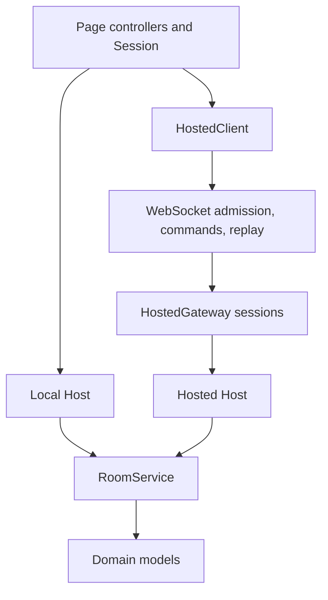
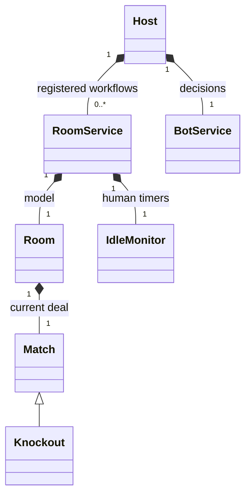
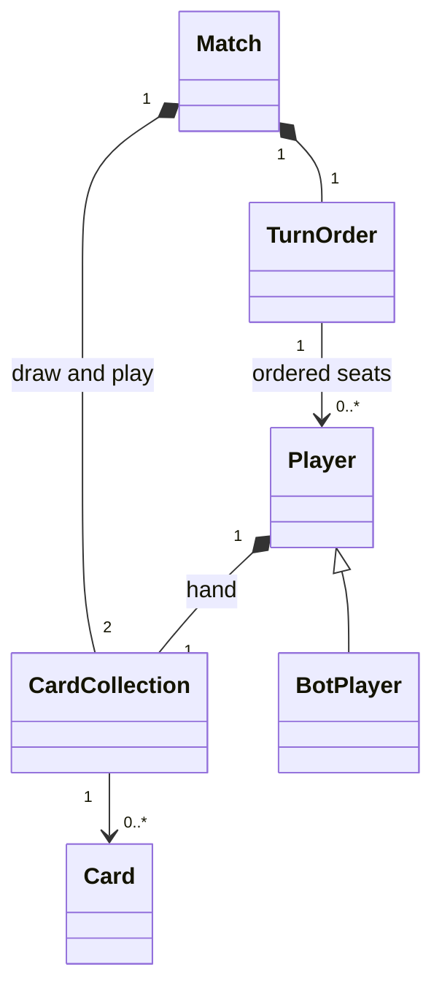
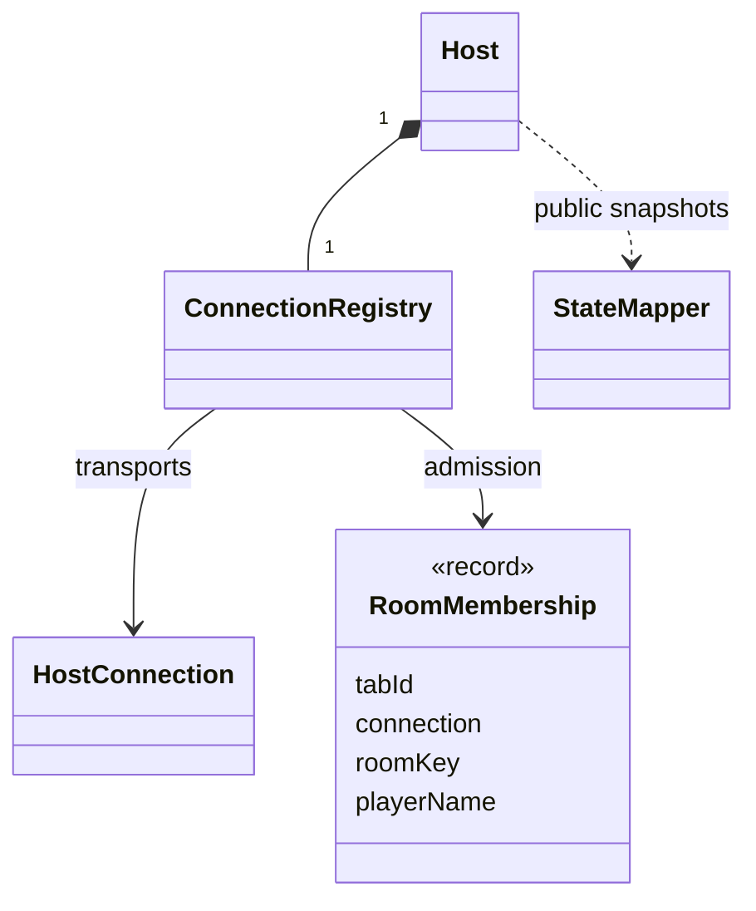
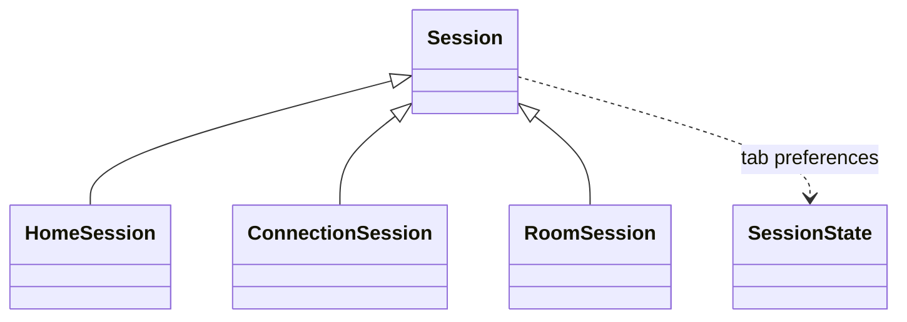
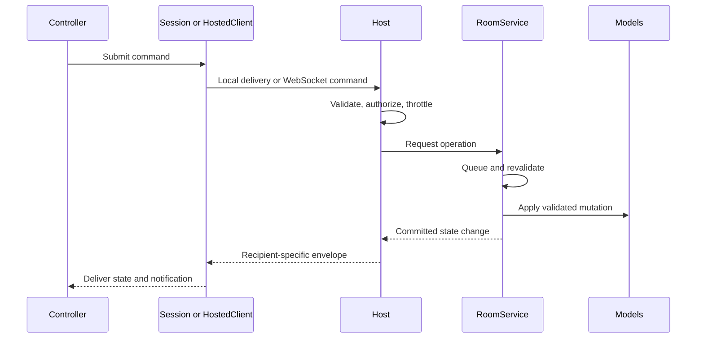

# Pick 2 — Software Design Description

| Document ID | Revision | Software baseline |
| --- | --- | --- |
| P2-SDD | 2.1 | 2026-11-12; package version 1.0.0, working tree |

## 1. Introduction

### 1.1 Purpose, scope, and references

This description records the architecture and detailed design realizing
[P2-SRS](software-requirements-specification.md). It uses the design-description
and viewpoint conventions of references [2] and [3] in the [register](README.md#5-references).
Wire schemas and resource budgets belong to [P2-ICD](interface-control-document.md);
setup and change practices belong to [P2-OM](operations-and-maintenance.md).

### 1.2 Stakeholders, concerns, and viewpoints

| Stakeholder | Concern | Design viewpoint |
| --- | --- | --- |
| Player / viewer | Correct rules, private hands, recoverable connections | Runtime sequences (§4), presentation (§5) |
| Developer | Clear ownership and common behavior across modes | Decomposition (§2), domain/data (§3) |
| Maintainer | Safe mutation, cancellation, and extension | Lifecycle/concurrency (§4), decisions (§7) |
| Operator | Bounded resources and deterministic cleanup | Deployment (§2.2), Hosted interfaces in P2-ICD |
| Tester | Observable contracts and repeatable verification | Realization map (§6), P2-VVP |

## 2. Architecture and decomposition

### 2.1 Component view

| Element | Responsibility and allowed dependency direction |
| --- | --- |
| `model/` | Identity, immutable cards, collections, transfers, turns, match outcomes; model/shared only; no timers |
| `service/` | Serialized game workflows, effects, idle eligibility, bot timing/strategy; service/model/shared only |
| `shared/` | Constants, protocol vocabulary, validation, expected user failures; shared only |
| `host/` | Registered services, authorization, membership records, throttling, lifecycle scheduling, StateMapper publication |
| `server/` | HTTP composition, Hosted credentials, live upgrade/frame protection, environment policy, process lifecycle |
| `ui/` | Page sessions, controllers, custom cards, templates, styles, display utilities |
| Root `main.js` | Browser startup and dependency wiring |

Host imports neither browser globals nor Node/Express/WebSocket implementations.
Controllers submit commands through `session` and render public snapshots, rather
than creating a second rules engine or alternate player DTO. The `room` getter
exposes the authoritative model reference; it is not an immutable model facade.

### 2.2 Deployment view

`config.js` owns the public deployment endpoint imported by SessionState. Static
hosting supplies this small module directly; Node serves an equivalent noncached
module from `GAME_SERVER_ORIGIN` with validation before listening. Game constants
remain independent of deployment settings. `HttpApplication.js` allows only browser
entry points, required Local-play modules, and presentation assets; repository and
server internals are not static resources. See P2-OM §2.2 and P2-ICD §6.

Local mode creates a browser-owned Host and isolated room registry. Session clones
messages for in-process delivery. Hosted mode creates one Node Host; HttpApplication
serves approved assets/configuration and health, while WebSocketGateway protects
the single live channel. HostedGateway owns retained HostConnection membership.
The browser and Node entry points are respectively `main.js` and `server/main.js`.
Neither mode has durable storage or multi-process room coordination.

### 2.3 UML class views

`*--` denotes owned state, `-->` a reference, and `<|--` actual inheritance. The
membership type below is a plain record, not a separately implemented class.

Room, Match, and Knockout have separate model modules. ViewController provides
common view/dialog behavior; page, local-player, and dialog controllers specialize
it. FaqController is independent; PlayingCard extends HTMLElement.

## 3. Domain and information design

### 3.1 State and resource ownership

| Owner | Authoritative state or resource |
| --- | --- |
| Card | Frozen validated value/suit/rotation and derived rank/ID |
| CardCollection | Mutable item sequence; derived count and penalty; deck factory, sorting, legal-card/suit queries |
| Player / BotPlayer | Name/key, hand, state, draw allowance; no timers or command executors |
| TurnOrder | Player map, ordered keys, direction, nullable `ownerKey`; no activity timestamps |
| Match | TurnOrder, draw/play collections, state, pending declaration, declared suit, last discarder |
| Knockout | Match specialization, continuation flag, sidelined bot names; ordinary Match retains no bot roster |
| Room | Name, capacity, viewers, timestamps, current Match |
| RoomService | One Room, mutation queue, game revision, automation AbortController, IdleMonitor, publication callbacks |
| Host | Registered services, runtime profile, orchestration, room/Knockout/bot-return schedulers |
| ConnectionRegistry | Home subscriptions, membership records, room-to-tab indexes |
| HostConnection / RequestThrottle | Delivery/authentication lifetime / rate history |
| HostedGateway | Secret-token sessions, socket ownership, bounded replay, liveness and admission accounting |
| WebSocketGateway | Upgrade/frame/write limits, authentication deadlines, socket heartbeat/close resources |
| Session (`ui/Session.js`) | Local delivery identity, page controllers, transport lifetimes |
| SessionState (`ui/SessionState.js`) | Tab preferences, admission intent, carried notice; no controllers or transports |
| HostedClient | In-memory credential, current socket, event cursor, authentication deadline, retry timers |
| UI controller | DOM references, display snapshot, selection, dialog transitions, presentation timers |

Core viewer identities count observers independently of transport membership.
Host coordinates both representations on admission/departure. Normalized room/player
keys support lookup but do not replace display-name validation. There are no SQL
records, application accounts, persisted results, or saved-game schemas.

### 3.2 Serialization and public mapping

Host authenticates and dispatches card commands directly to RoomService; StateMapper
converts the committed result into an immutable action notification, exposing counts
rather than drawn card identities. HostConnection owns the open-connection delivery
guard. RoomService shares player/turn validation and hand-sort setup across Draw,
Pass, and Discard while retaining the single mutation queue and distinct card rules.

Serializable traverses supported models, dates, arrays, sets, maps, and plain
records. Model underscore fields, functions, and undefined fields are excluded;
field allow/denylists remain available. Plain-record underscore keys remain data;
literal prototype keys are created as own properties rather than prototype setters.
Card serialization retains `{ value, suit, rank, rotation }`.

Room serialization contains private authoritative hands. Host shall therefore use
StateMapper for each recipient, including Local delivery. The public field/privacy
schema is defined only in P2-ICD §4. Results controllers retain their displayed
snapshot so later roster changes do not rewrite an already rendered result.

## 4. Runtime and lifecycle design

### 4.1 Startup and admission sequence

1. Browser `main.js` chooses the page session. Home honors an explicit mode choice;
   otherwise an empty configured origin selects Local and a configured origin Live.
2. Local Session creates Host and opens a cloned-message route. HostedClient opens
   `/live` and sends `create`, or `authenticate` with its in-memory token/cursor when
   reconnecting. A validated version-2 ready frame opens the page's command flow.
3. Home requests the directory over that channel. Before entering Room, HomeSession
   stores Create, Join, or View intent and mode; room names are encoded in navigation.
4. RoomSession restores intent or uses a room URL as a View request. Creation success
   persists Join intent; retained-session reconnect does not repeat admission.
5. Host validates a plain command context, reserves capacity, authenticates membership,
   and invokes RoomService. ConnectionRegistry records the resulting seat or viewer.
6. Host maps public state; Local delivery clones it and Hosted delivery pushes a
   sequenced event. No HTTP admission acknowledgement or directory race exists.

Each Host reserves capacity before yielding to asynchronous creation work. Failed
creation disposes/unregisters the reserved service. Creation and closure explicitly
refresh Home subscribers; every card action does not trigger a directory broadcast.

### 4.2 Command sequence and state transitions

RoomService serializes seated membership/game mutations. `perform()` resumes an
ordinary finished match and applies its requested action in the same queue slot.
Match reset initializes the deck once, resets players, deals the opening discard
and hands, establishes an owner, and publishes active state. A failed operation
releases the queue for subsequent work; it does not poison later requests.

A legal ending discard delegates result resolution to Match/Knockout. Ordinary
finished state remains observable until another accepted command resumes waiting
or starts a match. Knockout retains its finished roster until continuation prunes
nonqualifiers; Host updates eliminated human memberships and restores sidelined bots
when the series is complete. Domain rules are specified in P2-SRS §4.

### 4.3 Automation, activity, and disposal

BotService captures the current automation signal and game revision before its
presentation delay. It checks cancellation/ownership before evaluating strategy;
RoomService checks generation, revision, active state, and the exact seated owner
again inside the queue. This blocks old-match, replaced-player, and duplicate
same-owner decisions. A new match replaces the signal even when Knockout reuses
the Match object. Viewer-only mutations do not invalidate game decisions.

Host's automated-turn loop also uses the service revision to detect progress; it
stops after a decision that commits no game mutation, without comparing a separate
list of card/turn fields. A committed draw can keep the same owner and still advance
the revision so the bot can subsequently play or pass.

Successful game mutations update Room.lastActiveAt, increment game revision, and
refresh eligible human timers. Actual viewer changes update room activity without
resetting the human turn window. IdleMonitor owns all player timers. Host handles
idle demotion, empty-room grace, and room removal using the eligibility in P2-SRS.

`dispose()` aborts automation, clears idle resources and callbacks, and permanently
rejects subsequent queued game mutations. Host disposes services on closure,
failed registration, and shutdown. Shutdown cancels Host schedulers and disposes
rooms while Hosted session work drains, rather than waiting for obsolete bot delays.

### 4.4 Recovery and error boundaries

Home opens HostedClient directly; socket readiness replaces HTTP preflight. Session
stops the client on mode change/page departure, invalidating delayed callbacks.
HostedClient tracks network retry attempts separately from protocol failures.
Ready frames reset ordinary connection retry accounting, while protocol failures
remain counted until an explicit client start. This prevents malformed event streams
or repeated cursor rejections from creating an endless ready/reconnect loop.
ConnectionSession owns one manual HostedClient attempt with retries disabled and
releases its temporary session before returning Home. There is no parallel probe
lifecycle or persisted "verified endpoint" state.

Socket loss detaches a stream, retaining its session's membership until expiry.
Reconnect reauthenticates the same credential/cursor and replays missed events;
a retained session does not repeat admission. Expired credentials create a new
session and normal admission. No uncertain mutation is automatically replayed.
The field-level recovery protocol belongs to P2-ICD §3.

UserNotification represents expected user failures. Unexpected domain/transport
failures remain ordinary errors, are logged diagnostically, and receive generic
public server messages. A controller callback exception is logged as a page failure
without retiring credentials or entering network recovery. Combined Home/closure
responses carry the notice across navigation instead of dropping it.

## 5. Presentation design

### 5.1 Pages, layout, and dialogs

Home's HTML guide covers modes/admission; the Room FAQ covers matches/rules.
Both use native nested `details` and shared FAQ styles. Canonical Home metadata and
`sitemap.xml` expose the public Home URL; Room/Connection are excluded from indexing.
The default layout is mobile-first with its wider stage at 721px. Base/table
foundations live in the corresponding stylesheets. Hover/focus table rows use
translucent cyan; selection uses cyan text without a selected-row background.
Mutable presentation uses existing `data-*` hooks and DomUtils.setBooleanState.
Templates resolve relative to their owning module. Display order starts with the
local player while preserving circular order.

| Dialog | Opening trigger | Completion / dismissal behavior |
| --- | --- | --- |
| Alert | Normalized client/Host notification | Dismiss button hides it; carried Home notices are consumed on Home |
| Countdown | Seated local waiting-to-active transition | Timer or dismissal closes it; viewers do not receive it |
| Suit selection | Local owner has a pending declaration | Accepted declaration or changed snapshot hides it; temporary dismissal schedules redisplay |
| Results | Seated local first transition into finished | Dismissal clears details; repeated finished snapshots do not reopen it |

### 5.2 PlayingCard interaction contract

A PlayingCard is interactive only when created with an HTMLElement drop destination.
No destination creates a static card, including discards, FAQ examples, spectator
hands, results, and suit-only markers. A local hand can flip/drag while waiting or
finished and during an allowed active turn. Pending decisions and transport-busy
states disable interaction. The Home decorative fan is aria-hidden.

Cards expose `data-value`, `data-suit`, `data-is-face-up`, and retained `data-rank`.
Static cards use `role="img"` and descriptive names. Interactive cards additionally
have a drag handle, `role="button"`, `tabindex="0"`, and drag state. `rotation` uses
`--card-rotation`; null delegates to CSS. Programmatic face/rotation updates are
valid for either card kind. `update(card)` validates before changing identity,
cancels an active drag, and preserves face state.

Drag previews are new static cards preserving face/rotation. Their height captures
the source's computed pixel height at drag start; width/details derive from it.
Rotated bounds and viewport size do not choose that height. A valid target release
dispatches `card_drop` with `{ card: { value, suit }, source, target }`; elsewhere
restores the source. The custom element never mutates game collections. RoomController
submits Discard through the session; discard cards cannot be dragged back to a hand.

## 6. Bot design and requirement realization

BotStrategy copies its decision snapshot, uses CardCollection legality/suit queries,
and estimates unknown responses through CardOdds. It uses the current public discard
pile after recycling and never reads the draw collection. Projected returns to the
bot count as hand continuation; two-player jack/eight have no distinct opponent target.

Its decision order evaluates legal actions, shield release, first/following targets,
finish risk, redundant-ace conservation, then tactical score. It sheds penalty when
all alternatives permit an unavoidable opponent finish, recognizes legal two-player
skip-chain finishes, and includes multi-card seven-of-hearts finishes in risk checks.
Hand setup rewards reachable remaining penalty, not card count alone. Attack
selection examines downstream defenses/finishes; defense during a draw attack
prioritizes legal counters/shields without vetoing them for a later threat.

An equally safe ordinary play preserves an ace that would declare the current suit.
Without an attack, the bot preserves ace of spades and draws if it has no alternative;
after drawing it releases that shield only when the next opponent does not have
exactly one card, otherwise passing. Suit choice first avoids immediate/following
finishes, then favors held suit frequency, held penalty, and unknown-card scarcity.
These are tested strategy policies subordinate to authoritative legality.

| Requirement concern | Realization |
| --- | --- |
| Rules, results, Knockout | Card, Match, Knockout, TurnOrder, RoomService |
| Authorization and membership | Host and ConnectionRegistry records |
| Public privacy and shape | host/StateMapper.js, before either transport |
| Serialized/cancelled automation | RoomService queue/revision/signal, BotService, IdleMonitor |
| Recovery and retained membership | HostedClient, HostedGateway, WebSocketGateway |
| Accessible state rendering | Controllers, PlayingCard, HTML/CSS hooks |

The complete requirement-to-test matrix is maintained in P2-VVP §3.

## 7. Design decisions and extension rules

| Decision | Rationale / consequence |
| --- | --- |
| One WebSocket channel for browser-only Hosted clients | Removes HTTP command routing, request cancellation/CORS plumbing, preflight probes, and concurrent directory delivery; retains session authority and bounded replay |
| In-memory single-Host ownership | Small deployment and shared rules across modes; no restart or distributed recovery |
| Models separated from workflows | Rules/state remain transport-independent; services own timers and orchestration |
| Plain command/membership records | Avoids data-only wrapper classes and unnecessary file hops |
| Mapping co-located with Host | Publication has one explicit privacy boundary; raw serialization remains internal |
| Retained bounded replay | Recovers notifications across a dropped socket without replaying mutations |

Add behavior to its existing owner before introducing another layer. Shared rules,
rank policy, validation, mapping, templates, and presentation utilities remain single
sources. A change to transport or another major architectural boundary requires an
explicit fit/tradeoff recommendation before implementation. Extend the requirements,
interfaces, and verification together; coding and review procedures belong to P2-OM.
